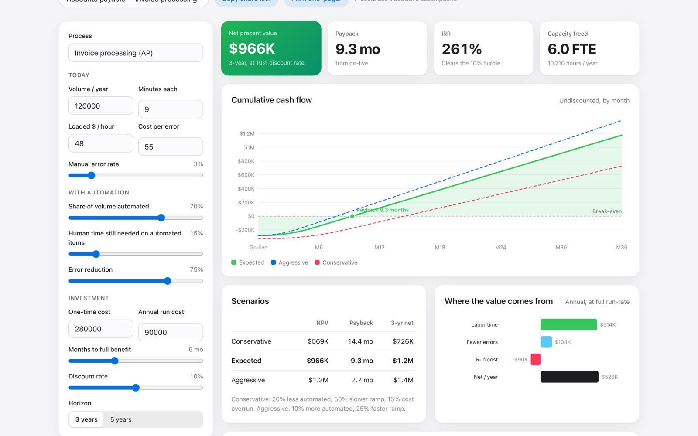

# Value Case

An automation business-case builder: NPV, IRR, payback, scenarios, sensitivity analysis, and a printable executive one-pager.

**[Live demo →](https://darshanpatil.me/work/value-case/)**



## The problem

Automation and AI projects get approved on the strength of their business case, but most cases are one-off spreadsheets with a single optimistic number. Executives want to know the downside, how quickly the project pays back, and which assumption the whole case hinges on.

## What it does

- Takes operational inputs (volume, handling time, labor rate, error rate, automation share, costs, ramp time) and builds a monthly cash-flow model.
- Reports **NPV, IRR, payback period, and freed capacity (FTE)**.
- Compares **conservative / expected / aggressive** scenarios on one chart.
- Builds a **tornado chart** showing which input moves NPV most when changed ±20%.
- Writes an **executive summary** with a recommendation, which you can copy or print as a one-pager.
- Saves every input in the URL so a case can be shared as a link.
- Includes four illustrative presets: AP invoices, KYC onboarding, IT ticket triage, and claims intake.

## How it works

- **Benefits:** labor savings = volume × share automated × (1 − residual human time) × minutes ÷ 60 × loaded rate. Error savings = automated volume × error rate × reduction × cost per error. Benefits ramp linearly to full run-rate.
- **Costs:** the one-time cost lands at month 0; run cost is spread evenly by month.
- **NPV:** monthly cash flows discounted at the annual rate converted to a monthly rate.
- **IRR:** solved by bisection on monthly flows, then annualized.
- **Sensitivity:** each driver is moved ±20% with everything else held constant, and the results are sorted by impact.

Presets are illustrative assumptions, not client data.

## Run it locally

No build step and no dependencies. Serve the folder with any static server:

```bash
python3 -m http.server 8000
# open http://localhost:8000
```

## Project structure

```
index.html   page layout and copy
app.js       data generation, model, and rendering
app.css      page-specific styles
kit.js       shared helpers: seeded RNG, CSV import/export, SVG charts, tooltips
kit.css      shared UI kit (light + dark mode)
```

Charts are hand-built SVG with no charting library. Everything runs client-side, so uploaded files never leave the browser.

## Data

The bundled sample data is **synthetic**, generated from a seeded random process so it is reproducible. It does not describe any real company or customer.

---

Built by [Darshan Patil](https://darshanpatil.me) · [LinkedIn](https://www.linkedin.com/in/darshan-patil-/)
